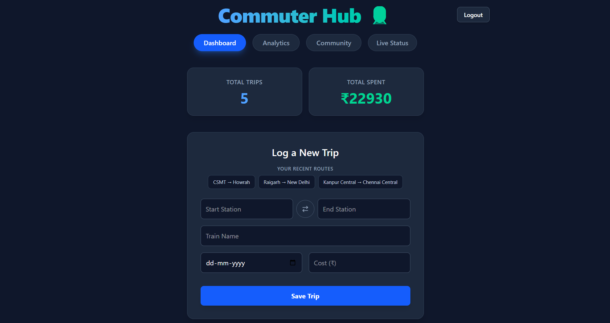
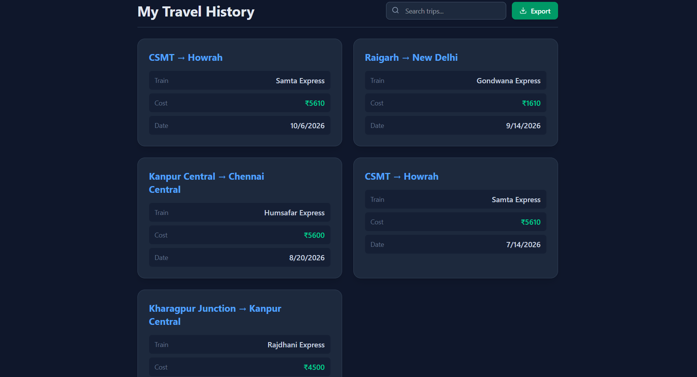
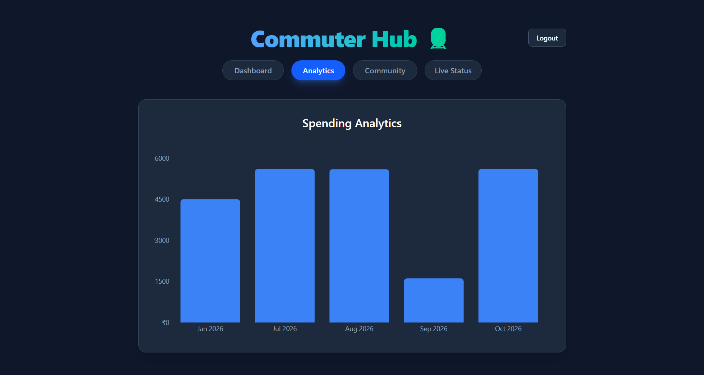
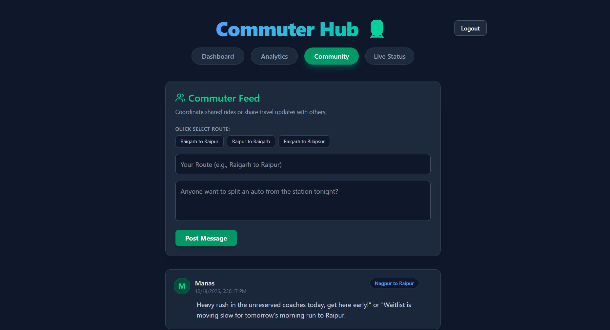
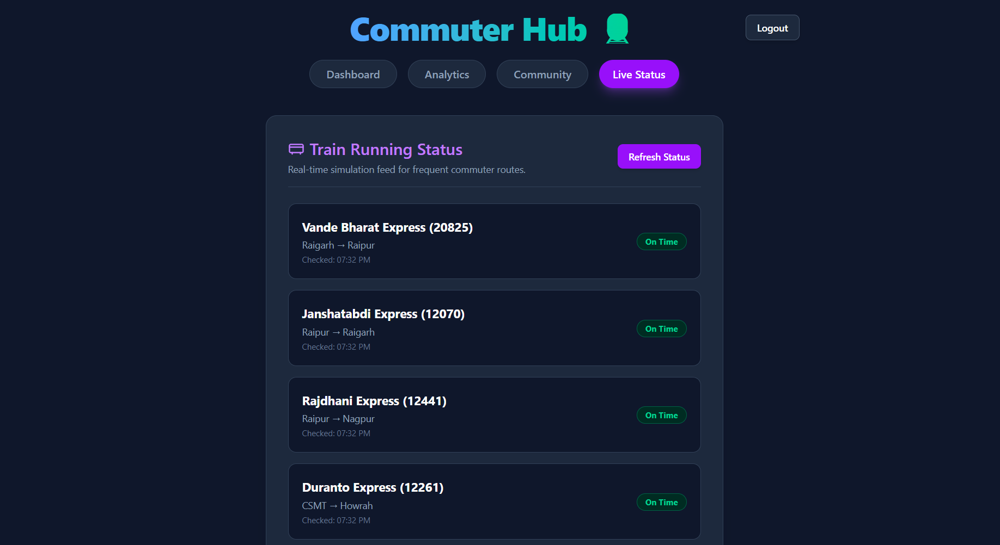
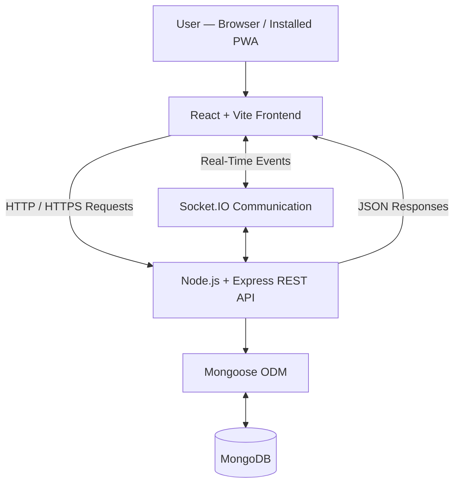

# 🚆 Commuter Hub

<div align="center">

### Your Daily Commute, Organized.

**Track Trips. Share Updates. Commute Smarter.**

A full-stack Progressive Web App built to help daily train commuters organize journeys, monitor travel expenses, explore commuting analytics, and connect through a real-time community.

<br />

[](https://commuter-hub-frontend.onrender.com/)
[](https://react.dev/)
[](https://nodejs.org/)
[](https://www.mongodb.com/)
[](https://socket.io/)

[**Explore the Application**](https://commuter-hub-frontend.onrender.com/) · [**View Source Code**](https://github.com/manas6265517/commuter-hub)

</div>

---

## 📌 Overview

Commuter Hub brings everyday commuting activities into one convenient, mobile-friendly platform.

Instead of managing travel records separately, commuters can use a centralized dashboard to record train journeys, review previous trips, track cumulative expenses, and access a community interface for sharing travel updates.

Built with the **MERN stack**, Socket.IO, and Progressive Web App technologies, the project demonstrates full-stack development, REST API integration, real-time communication, database operations, responsive UI development, and cloud deployment.

### 🎯 The Problem

Daily commuters often need a convenient way to keep track of their journeys, understand recurring travel costs, and exchange useful route information.

### 💡 The Solution

Commuter Hub combines journey management, expense analytics, and real-time community features in a single application designed around the daily commuter's workflow.

---

## ✨ Key Features

### 📱 Progressive Web App

- Installable application experience on supported devices.
- Standalone interface for convenient access.
- Responsive layouts designed for mobile and desktop screens.
- PWA capabilities configured using Vite PWA tooling.

### 🚆 Journey Management

- Record train journeys and maintain a travel history.
- Review previously logged trips from a dedicated interface.
- Keep journey information organized in one place.
- Access commuting records without relying on scattered notes.

### 💰 Travel Expense Tracking

- Record and review travel-related expenses.
- Calculate cumulative commuting expenses from stored trip data.
- View important travel statistics from the dashboard.
- Make recurring commuting costs easier to understand.

### 📊 Travel Analytics Dashboard

- Review journey statistics and travel summaries.
- Understand cumulative travel expenses.
- Access commuting information through a visual dashboard.
- Keep important travel metrics accessible from one place.

### 💬 Real-Time Community

- Share commuting updates with other users.
- Support real-time communication through Socket.IO.
- Exchange route-related information through the community interface.
- Receive updates without requiring a full-page reload.

### 📍 Live Status Interface

- Dedicated interface for commuting status information.
- Organized access to status-related details within the application.

*Live railway data, automatic train-delay notifications, and official railway API integration should only be claimed if they are implemented and connected to a reliable data source.*

### 🎨 Modern User Interface

- Responsive layouts for different screen sizes.
- Dark-themed visual design.
- Tailwind CSS v4 styling.
- Component-based React frontend.

### ☁️ Full-Stack Deployment

- Separate frontend and backend deployments.
- Express-based REST API.
- MongoDB database integration.
- Socket.IO communication between connected clients and the server.

---

## 🖥️ Application Preview

Explore the main screens of Commuter Hub, from the dashboard to journey history, analytics, community interactions, and live status.

### 01 — Dashboard

Your commuting overview, bringing key travel statistics and recent activity together in one place.



### 02 — Complete Travel History

Review your recorded train journeys in one place. This screen provides access to your historical commuting records.



### 03 — Travel Analytics

Explore travel statistics and expense summaries to better understand your commuting activity.



### 04 — Real-Time Community

A community interface for sharing travel updates and communicating with fellow commuters.



### 05 — Live Status

The dedicated status interface, designed to make commuting-related information easier to access.



---

## 🛠️ Technology Stack

| Layer | Technologies |
|---|---|
| Frontend | React.js, Vite |
| Styling | Tailwind CSS v4 |
| PWA | Vite PWA tooling |
| Backend | Node.js, Express.js |
| API Architecture | REST |
| Real-Time Communication | Socket.IO |
| Database | MongoDB |
| Object Data Modeling | Mongoose |
| Deployment | Render |
| Version Control | Git, GitHub |

---

## 🏗️ System Architecture

Commuter Hub uses a decoupled client-server architecture. The frontend handles the user interface, REST API requests, and real-time client connections, while the backend manages application logic and database operations.



### Application Flow

1. Users interact with the React frontend through a browser or supported installed PWA.
2. The frontend communicates with the Express backend through REST API endpoints.
3. The backend processes requests and performs the relevant database operations.
4. Mongoose provides the object-modeling layer for MongoDB interactions.
5. Socket.IO enables real-time communication for supported community features.

---

## 🚀 Getting Started

Run the application locally by following the instructions below.

### Prerequisites

Install the following tools before starting:

- [Node.js](https://nodejs.org/) — preferably an active LTS release.
- npm — included with Node.js.
- [Git](https://git-scm.com/).
- A MongoDB database, either local or hosted through [MongoDB Atlas](https://www.mongodb.com/atlas).

### 1. Clone the Repository

```bash
git clone https://github.com/manas6265517/commuter-hub.git
cd commuter-hub
```

### 2. Set Up the Backend

```bash
cd backend
npm install
```

Create a `.env` file inside the `backend/` directory:

```env
MONGO_URI=your_mongodb_connection_string
PORT=5000
```

Replace the placeholder with your actual MongoDB connection string. Add any other environment variables required by your backend.

Start the backend development server:

```bash
npm run dev
```

The backend is expected to listen on port `5000` if that is the port configured in your application.

### 3. Set Up the Frontend

Open a second terminal at the repository root:

```bash
cd frontend
npm install
npm run dev
```

Open the local URL displayed by Vite, typically:

`http://localhost:5173`

Make sure the frontend's API configuration points to your local backend and that the Socket.IO client uses the correct backend URL.

### 4. Verify the Application

After both services start:

- Open the frontend in your browser.
- Record a test journey and confirm it appears in travel history.
- Check that the dashboard and analytics reflect the expected data.
- Open the community interface in two browser sessions and test real-time communication.
- Verify the live-status interface behaves as intended.

*The exact commands and environment variables depend on the scripts and configuration in your repository.*

---

## 🌐 Deployment

The application uses separate frontend and backend services.

| Component | Platform / Service |
|---|---|
| Frontend | Render |
| Backend API | Render |
| Database | MongoDB / MongoDB Atlas |

### Production Configuration Checklist

- [ ] Configure backend environment variables in Render.
- [ ] Set the frontend API base URL to the deployed backend.
- [ ] Configure Socket.IO to connect to the production backend.
- [ ] Restrict CORS to trusted frontend origins.
- [ ] Verify MongoDB network access and credentials.
- [ ] Check the PWA manifest and production assets.
- [ ] Test API requests and real-time communication after deployment.

**Live application:** [commuter-hub-frontend.onrender.com](https://commuter-hub-frontend.onrender.com/)

---

## 🔐 Security and Reliability

Security and maintainability are important considerations for a full-stack application.

- Keep database credentials and secrets in environment variables.
- Never commit `.env` files or private credentials to GitHub.
- Validate incoming API data on the backend.
- Configure production CORS policies for trusted origins.
- Handle API errors and database failures gracefully.
- Validate the production configuration before deploying changes.

---

## 🗺️ Roadmap

Potential improvements for future releases:

- [ ] Advanced monthly expense reports and date-based filtering.
- [ ] Improved journey search by route, station, and date.
- [ ] Push notifications for relevant commuting updates.
- [ ] Enhanced offline access to previously saved travel records.
- [ ] Expanded authentication and user profile management.
- [ ] Automated tests for critical API and frontend workflows.
- [ ] Improved accessibility and mobile usability.

*Roadmap items represent possible future enhancements, not necessarily features currently available.*

---

## 🤝 Contributing

Suggestions, bug reports, and improvements are welcome.

1. Fork the repository.
2. Create a feature branch.
3. Implement and test your changes.
4. Commit your changes with a clear message.
5. Open a pull request describing your contribution.

---

## 👨‍💻 Author

**Manas Ranjan Haiburu**

- GitHub: [@manas6265517](https://github.com/manas6265517)
- LinkedIn: [Manas Ranjan Haiburu](https://www.linkedin.com/in/manas-ranjan-haiburu-4378332b7/)

---

<div align="center">

### 🚆 Commute Smarter with Commuter Hub

Built to make everyday commuting more organized, connected, and insightful.

**If you find this project interesting, consider giving the repository a ⭐!**

[**Live Demo**](https://commuter-hub-frontend.onrender.com/) · [**Source Code**](https://github.com/manas6265517/commuter-hub)

</div>